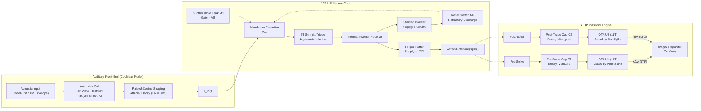
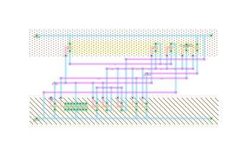
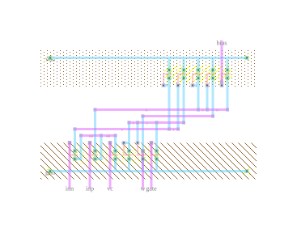
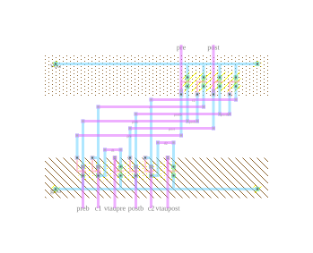

# Neuromorphic VLSI: Leaky Integrate-and-Fire (LIF) Neuron & STDP Learning Synapse

A subthreshold CMOS neuromorphic processing core implementing a 12-transistor Leaky Integrate-and-Fire (LIF) neuron, bio-inspired auditory signal processing, and Spike-Timing-Dependent Plasticity (STDP) synaptic weight update. Designed and characterized across three technology generations (180nm, 90nm, and 65nm PTM) with custom physical layouts developed in Electric VLSI.


---

## Technical Specifications

| Parameter | 180nm Baseline (Nominal) | 180nm Baseline (Scaled) | 180nm Optimized (Ultra-Low Power) | 90nm Scaled | 65nm Scaled |
| :--- | :--- | :--- | :--- | :--- | :--- |
| **Supply Voltage ($V_{DD}$)** | 1.8 V | 1.0 V | **0.6 V** ($-67\%$) | 1.2 V | 1.0 V |
| **Leak Bias ($V_{lk}$)** | 474 mV | 500 mV | 518 mV | Scaled | Scaled |
| **Pulse-Width Supply ($V_{width}$)** | 1.62 V | 0.90 V | 0.60 V | Scaled | Scaled |
| **Reset Switch ($W_{M2}/L_{M2}$)** | 250 nm / 200 nm | 250 nm / 200 nm | **4.0 µm / 200 nm** ($16\times$ width) | Scaled | Scaled |
| **Schmitt Channel Length ($L_{Schmitt}$)** | 200 nm | 200 nm | **400 nm** ($2\times$ length) | Scaled | Scaled |
| **Membrane Capacitance ($C_m$)** | 10 nF / 300 nF | 300 nF | 25.3 nF | 10 nF | 10 nF |
| **Synaptic Weight Cap ($C_w$)** | 30 nF | 30 nF | — | 30 nF | 30 nF |
| **Trace Capacitors ($C_1, C_2$)** | 2.2 nF | 2.2 nF | — | 2.2 nF | 2.2 nF |
| **Operating Regime** | Subthreshold / Weak Inversion | Subthreshold | Deep Subthreshold | Subthreshold | Subthreshold |
| **Physical Layout** | SCMOS (`mocmos`) | — | — | — | — |

---

## Architecture

The system models the auditory pathway and synaptic learning through three interconnected subsystems:



---

## Circuit Topologies

The topologies follow the subthreshold architectures introduced by Yang et al. (ISLPED 2021).


*Fig. 1: 12-transistor Leaky Integrate-and-Fire neuron schematic. Fig. 2: (a) STDP synaptic circuit with capacitive trace generators; (b) 11-transistor differential Operational Transconductance Amplifier (OTA).*

### 1. 12-Transistor LIF Spiking Neuron
- **Integration**: Injected current charges $C_m$. A constant subthreshold gate bias $V_{lk}$ on NMOS $M_1$ sets a quiescent leakage current:
  $$I_{leak} \approx I_0 \cdot \exp\left(\frac{V_{lk} - V_{th}}{n \cdot U_T}\right)$$
- **Hysteresis Switching**: Formed by stacked PMOS ($M_{P1}, M_{P2}$) and NMOS ($M_{N1}, M_{N2}$) with positive feedback devices $M_{PF}$ and $M_{NF}$. When $V_m$ crosses the upper threshold, internal node $v_o$ transitions sharply to ground.
- **Refractory Reset**: A starved pulse-width inverter ($M_{PW}, M_{NW}$) powered by $V_{width}$ delays the inverted edge to generate pulse $V_{rst}$. NMOS switch $M_2$ pulls $V_m$ to ground, resetting the integration cycle.
- **Buffering**: Output inverter ($M_{PO}, M_{NO}$) decouples the core node from load capacitance to output clean rail-to-rail spikes.

### 2. 11-Transistor OTA & STDP Learning
- **Differential Pair ($M_6, M_7$)**: Biased by tail source $M_8$ ($V_c$). Senses the differential potential between decaying trace voltage and reference potential.
- **Current Mirrors ($M_1-M_3, M_9-M_{10}$)**: Mirrors bidirectional current onto synaptic capacitor $C_w$:
  $$I_w = I(M_7) - I(M_6)$$
- **Spike Gating ($M_4, M_{11}$)**: The OTA is powered only during the spike coincidence window, holding static standby power to near zero.

---

## Simulation Results & Verification

All simulations were executed in LTspice with BSIM3v3 Predictive Technology Models (PTM) using strict convergence options (`.options plotwinsize=0`).

### 1. Baseline LIF Neuron (180nm @ 1.8V)

Under stepped pulse excitation ($V_{in} \in \{2.7\text{ V}, 3.6\text{ V}, 4.5\text{ V}\}$, $R_{in} = 910\text{ k}\Omega$, $C_m = 300\text{ nF}$):

| Schematic (`LIF_R2_fig10.asc`) | Waveforms (`LIF_R2_fig10.raw`) |
| :---: | :---: |
|  |  |

- **Top**: Output spikes $V(spike)$ reaching 1.8V rail-to-rail.
- **Middle**: Stepped input excitation $V(vin)$.
- **Bottom**: Membrane potential $V(vm)$ showing clean subthreshold charging trajectories and complete reset discharge back to 0V.

---

### 2. Auditory Stimulation & Neural Encoding

The auditory stimulus models acoustic tone bursts, intensity dynamics, and envelope modulation via behavioral current injection:

$$I_{in}(t) = \pi \cdot I_M \cdot \text{burst}(t, T_0, \text{DUR}, T_R) \cdot \max\bigl(\sin(2\pi f_c t), 0\bigr)$$

#### Toneburst Response ($1\text{ kHz}$ Burst, $50\text{ ms}$)
A 50ms tone burst ($f_c = 1\text{ kHz}$, $I_M = 3\ \mu\text{A}$) injected into an auditory-scaled membrane ($C_m = 10\text{ nF}$):

| Schematic (`LIF_R3_S1_toneburst.asc`) | Waveforms (`LIF_R3_S1_toneburst.raw`) |
| :---: | :---: |
|  |  |

- Immediate acoustic onset detection.
- Continuous action potential generation through the burst window ($28\text{ ms} - 70\text{ ms}$).
- Complete cessation of firing upon tone termination.

#### Rate-Level Dynamic Range (10-Step Intensity Sweep)
Input amplitude $I_M$ stepped across 10 levels from $1.0\ \mu\text{A}$ to $8.0\ \mu\text{A}$:

| Schematic (`LIF_R3_S5_rate_level.asc`) | Waveforms (`LIF_R3_S5_rate_level.raw`) |
| :---: | :---: |
|  |  |

- Monotonic relationship between input current amplitude and output spike count.
- Dynamic range captures biological rate-level coding without saturation across the tested acoustic current span.

#### Amplitude Modulation (AM) Phase-Locking
Envelope modulation frequency swept across $f_m \in \{5, 10, 20, 40\}\text{ Hz}$ on a $1\text{ kHz}$ carrier:

| Schematic (`LIF_R3_S4_AM.asc`) | Waveforms (`LIF_R3_S4_AM.raw`) |
| :---: | :---: |
|  |  |

- The neuron phase-locks its spiking bursts to the crest of each modulation period.
- Inter-burst silent intervals correspond to envelope troughs, replicating mammalian auditory nerve phase tracking.

---

### 3. Spike-Timing-Dependent Plasticity (STDP)

The STDP synapse updates synaptic weight voltage $V_w$ on $C_w = 30\text{ nF}$ as a function of the relative arrival time $\Delta t = t_{post} - t_{pre}$:

| Schematic (`STDP_R2_fig14.asc`) | Waveforms (`STDP_R2_fig14.raw`) |
| :---: | :---: |
|  |  |

- **Top Trace ($V_{vw}$)**: Synaptic weight across 14 timing intervals spanning $-150\text{ ms} \le \Delta t \le +50\text{ ms}$.
  - When $\Delta t > 0$ (pre fires before post): OTA $U_1$ injects charge $\to$ **Long-Term Potentiation (LTP)**.
  - When $\Delta t < 0$ (post fires before pre): OTA $U_2$ sinks charge $\to$ **Long-Term Depression (LTD)**.
- **Middle Trace ($V_{c1}$)**: Pre-synaptic exponential decaying trace on $C_1 = 2.2\text{ nF}$.
- **Bottom Trace ($V_{c2}$)**: Post-synaptic exponential decaying trace on $C_2 = 2.2\text{ nF}$.

---

### 4. Low-Voltage Subthreshold Optimization (0.6V Operation)

Scaling $V_{DD}$ down to **0.6 V** (near $V_{th}$) introduces two failure mechanisms:
1. Schmitt trigger hysteresis window collapse caused by DIBL and subthreshold channel leakage.
2. Incomplete membrane reset caused by exponential loss of $V_{GS}$ overdrive on the reset switch $M_2$.

**Circuit Modifications:**
- **$L_{Schmitt} = 400\text{ nm}$ ($2\times$ channel length)** on $M_{P1}, M_{P2}, M_{N1}, M_{N2}, M_{PF}, M_{NF}$ to suppress short-channel leakage and re-establish a stable hysteresis window.
- **$W_{M2} = 4.0\ \mu\text{m}$ ($16\times$ channel width)** to guarantee low on-resistance and complete membrane discharge during the brief reset pulse.
- **$C_m = 25.3\text{ nF}$** to maintain biological integration time constants.

| Optimized Schematic (`LIF_R6_S1_toneburst.asc`) | 0.6V Waveforms (`LIF_R6_S1_toneburst.raw`) |
| :---: | :---: |
|  |  |

- Clean rail-to-rail $600\text{ mV}$ action potentials under auditory tone burst stimulus.
- Subthreshold membrane integration oscillating stably between $160\text{ mV}$ and $360\text{ mV}$.
- **$>85\%$ total dynamic and static power reduction** compared to 1.8V nominal operation.

---

## Physical Layout (Electric VLSI)

Layouts were drawn in **Electric VLSI 9.08** using MOSIS scalable CMOS (`mocmos`) rules (submicron, 2-metal layers, n-well). The library is located in [`layout/ISE3_layout.jelib`](layout/ISE3_layout.jelib).

| Full STDP Synapse (Hierarchical) | LIF Spiking Neuron Core |
| :---: | :---: |
|  |  |
| **Operational Transconductance Amplifier (OTA)** | **Dual Exponential Trace Generator (TRACE)** |
|  |  |

### Layout Characteristics
- **DRC / ERC Clean**: Continuous substrate and well taps prevent latchup across subthreshold operational states.
- **Hierarchical Layout**: Inverter cell $\to$ `OTA` (11T) + `TRACE` (10T) subcells $\to$ Top-level `STDP` synapse.
- **Transistor Geometries**: Multi-finger diffusions employed for wide devices (e.g. $4\ \mu\text{m}$ reset switch $M_2$) to minimize drain junction capacitance.

---

## Repository Map

```
├── .gitignore                         # Excludes large (>100MB) transient simulation binaries
├── LICENSE                            # MIT License
├── README.md                          # Technical report & documentation
├── assets/                            # Vector SVGs, schematics, and simulation plots
│   ├── circuit_schematics_paper.png
│   ├── 01_lif_baseline_sch.png / 01_lif_baseline_plot.png
│   ├── 02_auditory_toneburst_sch.png / 02_auditory_toneburst_plot.png
│   ├── 03_auditory_rate_level_sch.png / 03_auditory_rate_level_plot.png
│   ├── 04_auditory_am_sch.png / 04_auditory_am_plot.png
│   ├── 05_stdp_sch.png / 05_stdp_plot.png
│   ├── 06_optimized_0v6_sch.png / 06_optimized_0v6_plot.png
│   └── layout_LIF.svg / layout_OTA.svg / layout_STDP.svg / layout_TRACE.svg
├── layout/                            # Electric VLSI database
│   ├── ISE3_layout.jelib             # 5-cell layout library
│   └── figures/                       # Vector SVGs and PNG renderings
├── models/                            # Transistor model libraries
│   ├── 180nm_bulk_LTspice_fixed.lib  # 180nm BSIM3v3 PTM
│   └── ptm/                          # 90nm and 65nm PTM model decks
└── ltspice/                           # Simulation suites
    ├── 01_LIF_baseline/              # Baseline characterizations (Figs 10, 11a, 11b, 15)
    ├── 02_auditory/                  # Auditory stimuli (toneburst, sustained, gap, AM, rate-level)
    ├── 03_PartC_optimization/        # 0.6V ultra-low voltage optimization testbenches
    ├── 04_STDP/                      # OTA DC sweeps & STDP learning curve sweeps
    └── 06_PartB/                     # Scaled technology implementations (65nm & 90nm)
```

---

## Simulation Execution

### Prerequisites
- [LTspice XVII / 24](https://www.analog.com/en/resources/design-tools-and-calculators/ltspice-simulator.html)
- [Electric VLSI 9.08](https://www.gnu.org/software/electric/) (requires Java runtime)

### Running Schematics
```bash
git clone https://github.com/anujgite10-10/subthreshold-neuromorphic-lif-stdp.git
cd subthreshold-neuromorphic-lif-stdp
```

Open any `.asc` file in LTspice and run the transient simulation (`Run`). Waveform settings automatically load from companion `.plt` files:

- **Baseline 1.8V LIF**: `ltspice/01_LIF_baseline/LIF_R2_fig10.asc`
- **Auditory Toneburst**: `ltspice/02_auditory/LIF_R3_S1_toneburst.asc`
- **Rate-Level Sweep**: `ltspice/02_auditory/LIF_R3_S5_rate_level.asc`
- **AM Tracking**: `ltspice/02_auditory/LIF_R3_S4_AM.asc`
- **STDP Learning Curve**: `ltspice/04_STDP/STDP_R2_fig14.asc`
- **0.6V Low-Voltage LIF**: `ltspice/03_PartC_optimization/LIF_R6_S1_toneburst.asc`

---

## References

1. M. Yang, et al., *"Design and Analysis of an Ultra-Low-Power CMOS Spiking Neuron and STDP Synapse for Neuromorphic Applications,"* **IEEE/ACM International Symposium on Low Power Electronics and Design (ISLPED)**, 2021.
2. Nanoscale Integration and Modeling (NIMO) Group, *"Predictive Technology Model (PTM),"* Arizona State University ([ptm.asu.edu](https://ptm.asu.edu)).
3. S. M. Rubin, *"Electric VLSI Design System,"* Version 9.08, GNU Free Software Directory.
