<div align="center">

# Neuromorphic VLSI: Leaky Integrate-and-Fire (LIF) Neuron & STDP Learning Synapse

### Sub-Threshold CMOS Neuromorphic Processing Unit with Bio-Inspired Auditory Feature Extraction, STDP Synaptic Plasticity, Technology Scaling (180nm / 90nm / 65nm), Ultra-Low Voltage (0.6V) Optimization, and Full Custom Electric VLSI Layout

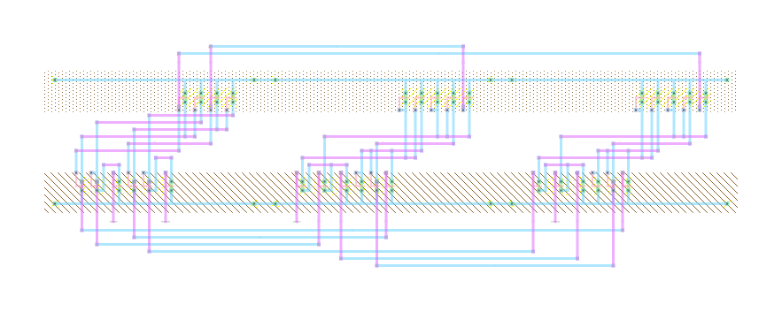

[](https://www.analog.com/en/resources/design-tools-and-calculators/ltspice-simulator.html)
[](https://www.gnu.org/software/electric/)
[](https://ptm.asu.edu/)
[](#low-voltage-optimization-06v-ultra-low-power)
[](LICENSE)

</div>

---

## 📖 Table of Contents

- [Overview & Architecture](#-overview--architecture)
- [Reference Circuit Schematics](#-reference-circuit-schematics)
- [1. Baseline LIF Neuron (180nm @ 1.8V & 1.0V)](#1-baseline-lif-neuron-180nm--180v--10v)
- [2. Auditory Feature Extraction & Neural Coding](#2-auditory-feature-extraction--neural-coding)
  - [2.1 Toneburst Response](#21-toneburst-response-50ms--1khz)
  - [2.2 Rate-Level Dynamic Range (Current Sweep)](#22-rate-level-dynamic-range-intensity-sweep)
  - [2.3 Amplitude Modulation (AM) Phase-Locking](#23-amplitude-modulation-am-phase-locking)
- [3. Spike-Timing-Dependent Plasticity (STDP) Learning Synapse](#3-spike-timing-dependent-plasticity-stdp-learning-synapse)
- [4. Low-Voltage Optimization (0.6V Ultra-Low Power)](#4-low-voltage-optimization-06v-ultra-low-power)
- [5. Technology Scaling (180nm → 90nm → 65nm)](#5-technology-scaling-180nm--90nm--65nm)
- [6. Physical Layout Gallery (Electric VLSI)](#6-physical-layout-gallery-electric-vlsi)
- [Repository Structure](#-repository-structure)
- [Quick Start: Simulation & Reproduction](#-quick-start-simulation--reproduction)
- [References](#-references)

---

## 🔬 Overview & Architecture

This repository presents the end-to-end design, SPICE modeling, auditory validation, low-voltage optimization, and physical layout of an analog **neuromorphic processing core**. The architecture is inspired by **Yang et al. (ISLPED 2021)** and realizes:

1. **Leaky Integrate-and-Fire (LIF) Neuron (12 Transistors)**: Employs a low-power Schmitt trigger with positive feedback hysteresis for sharp, rail-to-rail action potential generation and an adaptive pulse-width inverter to control refractory reset.
2. **Bio-Inspired Auditory Front-End**: Implements behavioral cochlear hair-cell processing (half-wave rectification, raised-cosine onset/offset ramps, envelope detection) to simulate acoustic tonebursts, amplitude modulation (AM), and intensity sweeps.
3. **STDP Learning Synapse (11-Transistor OTA + Trace Generators)**: Implements Spike-Timing-Dependent Plasticity using dual exponential trace decaying capacitors and a differential Operational Transconductance Amplifier (OTA) to update non-volatile weight capacitance ($C_w = 30\text{ nF}$).
4. **0.6V Subthreshold Optimization**: Successfully scales supply voltage down by $3\times$ (from $1.8\text{ V}$ down to $0.6\text{ V}$) through deliberate transistor geometry optimization ($L_{Schmitt} = 400\text{ nm}$, $W_{Reset} = 4\ \mu\text{m}$).
5. **Multi-Node Technology Scaling**: Validated on BSIM3v3 Predictive Technology Models (PTM) across **180nm**, **90nm**, and **65nm** nodes.
6. **Full Custom CMOS Layout**: Complete hierarchical layout created in **Electric VLSI** adhering to MOSIS scalable CMOS (`mocmos`) design rules.

### 🔄 End-to-End Neuromorphic Signal Pipeline

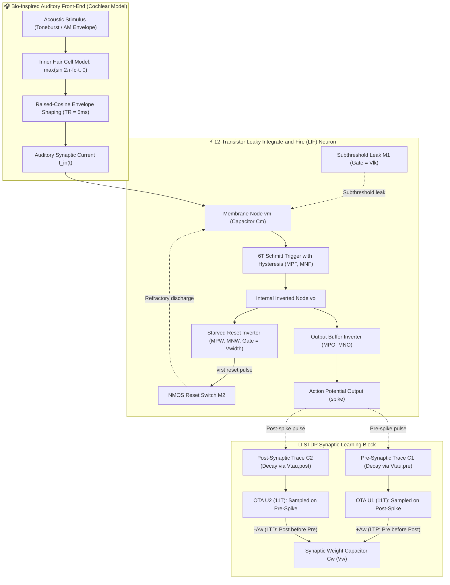

---

## 📐 Reference Circuit Schematics

The fundamental circuit topologies implemented in this project are shown below:

<div align="center">
  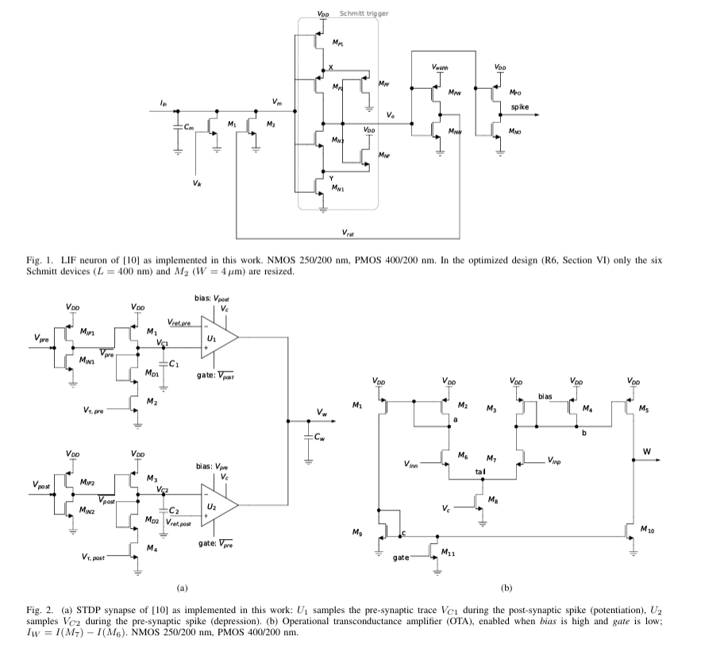
  <p><em>Fig. 1: 12-Transistor LIF Spiking Neuron & Fig. 2: (a) STDP Synapse with trace generators, (b) 11-Transistor Operational Transconductance Amplifier (OTA).</em></p>
</div>

- **LIF Core ($M_1 - M_2$, $M_{P1}-M_{P2}$, $M_{N1}-M_{N2}$, $M_{PF}, M_{NF}, M_{PW}, M_{NW}, M_{PO}, M_{NO}$)**:
  - $M_1$: Leak device operated in subthreshold regime via $V_{lk}$.
  - $M_2$: Membrane reset switch activated by pulse $V_{rst}$.
  - $M_{P1}, M_{P2}, M_{N1}, M_{N2}, M_{PF}, M_{NF}$: 6-transistor Schmitt trigger setting upper and lower switching thresholds.
  - $M_{PW}, M_{NW}$: Starved inverter powered by $V_{width}$ setting the refractory reset pulse duration.
- **OTA Core ($M_1 - M_{11}$)**:
  - Differential pair ($M_6, M_7$) biased by tail current source $M_8$ ($V_c$).
  - Current mirrors ($M_1-M_3, M_9-M_{10}$) transferring current difference $I_w = I(M_7) - I(M_6)$ onto $C_w$.
  - Gated sampling switches ($M_4, M_{11}$) enabled by pre/post spike pulses.

---

## 1. Baseline LIF Neuron (180nm @ 1.8V & 1.0V)

The baseline LIF neuron integrates incoming current on membrane capacitor $C_m = 300\text{ nF}$ via input resistor $R_{in} = 910\text{ k}\Omega$. Transistors are sized with $W_N = 250\text{ nm}, L_N = 200\text{ nm}$ for NMOS and $W_P = 400\text{ nm}, L_P = 200\text{ nm}$ for PMOS.

<div align="center">
  <table>
    <tr>
      <td align="center"><b>LTspice Schematic (<code>LIF_R2_fig10.asc</code>)</b></td>
      <td align="center"><b>Simulated Spiking Waveforms (<code>LIF_R2_fig10.raw</code>)</b></td>
    </tr>
    <tr>
      <td>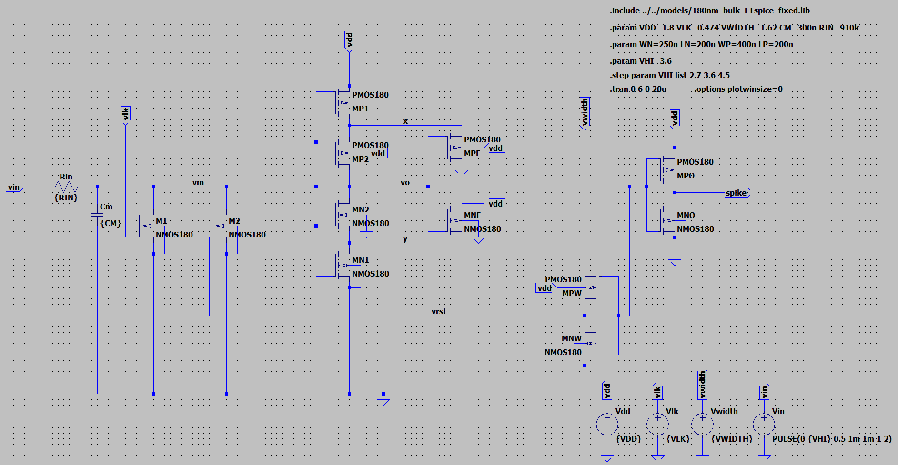</td>
      <td>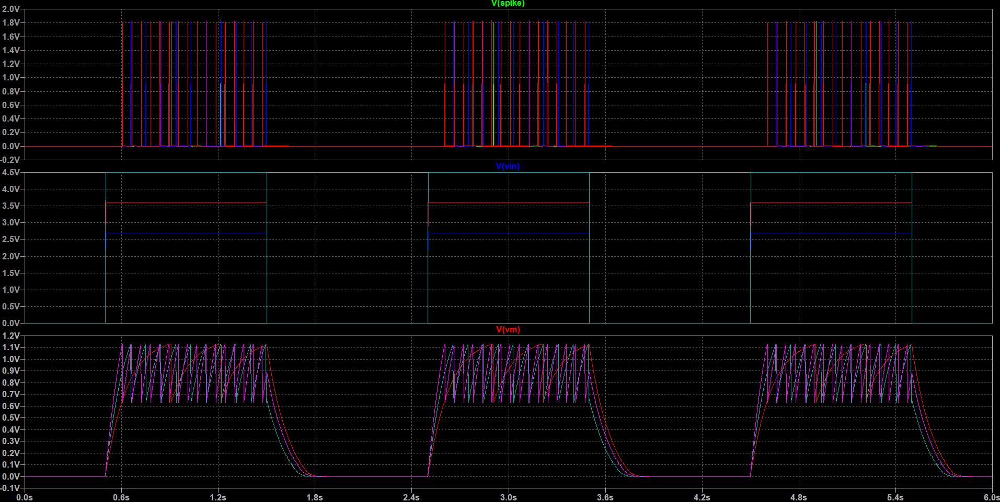</td>
    </tr>
  </table>
  <p><em>Top: Spikes <code>V(spike)</code>; Middle: Stepped input pulse <code>V(vin)</code> ∈ {2.7V, 3.6V, 4.5V}; Bottom: Membrane voltage <code>V(vm)</code> exhibiting steady integrate-fire-reset cycles.</em></p>
</div>

### Key Baseline Observations:
- **Hysteresis Window**: The Schmitt trigger creates clean transitions without multi-trigger oscillations.
- **Rate Coding**: Higher $V_{in}$ amplitudes pump more current into $C_m$, steepening the membrane integration slope and linearly increasing spike frequency.

---

## 2. Auditory Feature Extraction & Neural Coding

To validate the neuron in realistic bio-signal processing applications, a mathematical cochlear hair-cell model is integrated via [`auditory_stim.inc`](ltspice/02_auditory/auditory_stim.inc):

$$I_{in}(t) = \pi \cdot I_M \cdot \text{burst}(t, T_0, \text{DUR}, T_R) \cdot \max\bigl(\sin(2\pi f_c t), 0\bigr)$$

where:
- $\text{burst}(t)$ imposes raised-cosine attack and decay ramps ($T_R = 5\text{ ms}$) on a pulse duration $\text{DUR}$.
- $\max(\sin(2\pi f_c t), 0)$ models the half-wave rectification (HWR) performed by inner hair cells at carrier frequency $f_c = 1\text{ kHz}$.
- $C_m$ is adjusted to $10\text{ nF}$ to match biological acoustic timescales.

---

### 2.1 Toneburst Response (50ms @ 1kHz)

Driving the neuron with a $50\text{ ms}$ toneburst ($I_M = 3\ \mu\text{A}$) demonstrates immediate phase-locked acoustic firing followed by silence upon burst termination.

<div align="center">
  <table>
    <tr>
      <td align="center"><b>Toneburst Schematic (<code>LIF_R3_S1_toneburst.asc</code>)</b></td>
      <td align="center"><b>Toneburst Waveforms (<code>LIF_R3_S1_toneburst.raw</code>)</b></td>
    </tr>
    <tr>
      <td>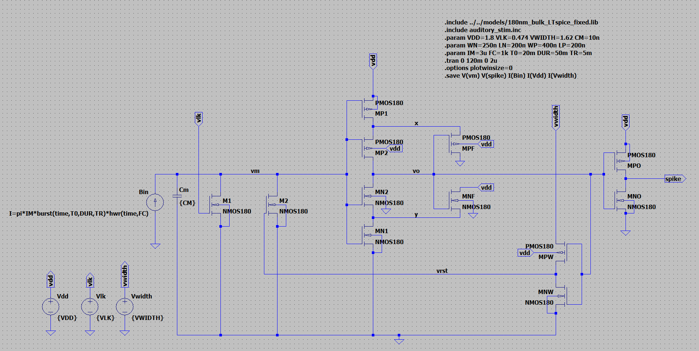</td>
      <td>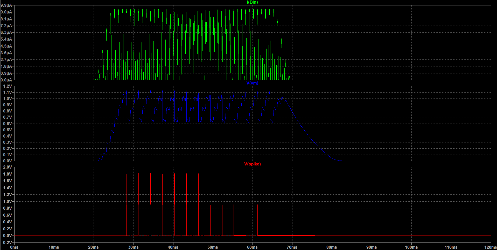</td>
    </tr>
  </table>
  <p><em>Top: Rectified auditory input current <code>I(Bin)</code>; Middle: Membrane potential <code>V(vm)</code>; Bottom: Action potentials <code>V(spike)</code>.</em></p>
</div>

---

### 2.2 Rate-Level Dynamic Range (Intensity Sweep)

To determine the neuron's input dynamic range, the acoustic amplitude $I_M$ was swept over 10 values from $1.0\ \mu\text{A}$ to $8.0\ \mu\text{A}$ ($\text{DUR} = 100\text{ ms}$).

<div align="center">
  <table>
    <tr>
      <td align="center"><b>Rate-Level Schematic (<code>LIF_R3_S5_rate_level.asc</code>)</b></td>
      <td align="center"><b>10-Level Stepped Firing Rate (<code>LIF_R3_S5_rate_level.raw</code>)</b></td>
    </tr>
    <tr>
      <td>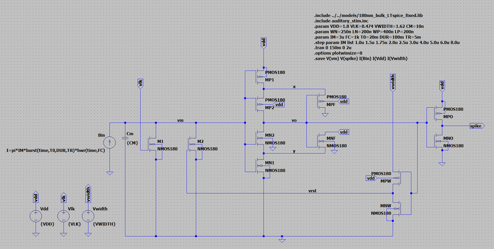</td>
      <td>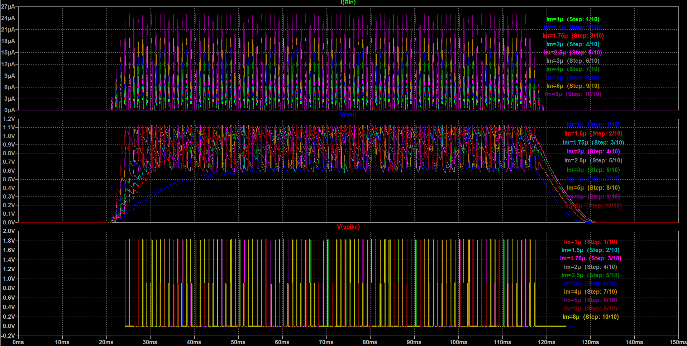</td>
    </tr>
  </table>
  <p><em>Color-coded response across 10 input levels (1µA to 8µA) demonstrating clear monotonic firing rate scaling.</em></p>
</div>

---

### 2.3 Amplitude Modulation (AM) Phase-Locking

Acoustic communication heavily relies on low-frequency envelope modulation. The neuron was stimulated with an AM envelope:

$$I_{in}(t) = \pi \cdot I_M \cdot 0.5 \cdot \bigl(1 - \cos(2\pi f_m t)\bigr) \cdot \max\bigl(\sin(2\pi f_c t), 0\bigr)$$

sweeping modulation frequency $f_m \in \{5, 10, 20, 40\}\text{ Hz}$.

<div align="center">
  <table>
    <tr>
      <td align="center"><b>AM Modulation Schematic (<code>LIF_R3_S4_AM.asc</code>)</b></td>
      <td align="center"><b>Phase-Locked Spiking (<code>LIF_R3_S4_AM.raw</code>)</b></td>
    </tr>
    <tr>
      <td>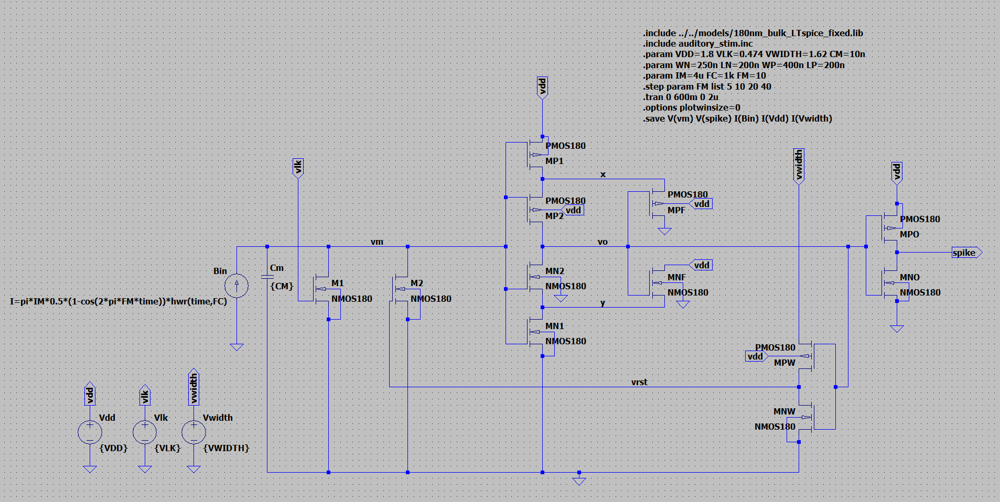</td>
      <td>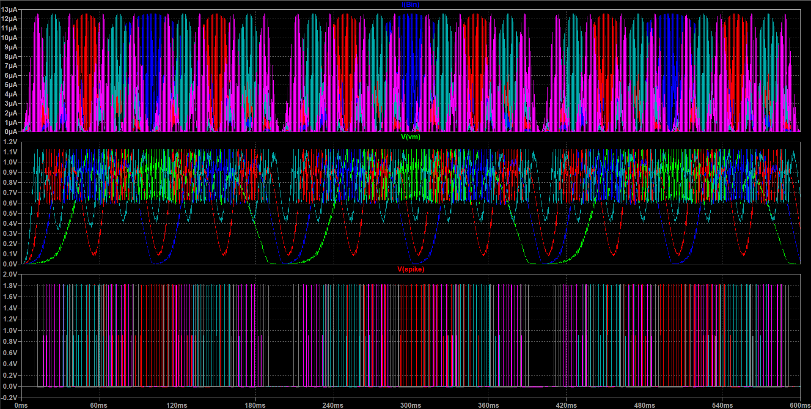</td>
    </tr>
  </table>
  <p><em>Multi-run plot across 600ms showing neural spikes faithfully phase-locking to envelope peaks for each modulation frequency.</em></p>
</div>

---

## 3. Spike-Timing-Dependent Plasticity (STDP) Learning Synapse

Synaptic weight adaptation follows biological Hebbian STDP:
- **Long-Term Potentiation (LTP)**: When the pre-synaptic neuron fires before the post-synaptic neuron ($\Delta t > 0$), synaptic weight $V_w$ increases.
- **Long-Term Depression (LTD)**: When post fires before pre ($\Delta t < 0$), $V_w$ decreases.

The circuit utilizes:
- Pre-synaptic trace on $C_1 = 2.2\text{ nF}$ decayed by NMOS $M_2$ ($V_{\tau,pre} = 0.31\text{ V}$).
- Post-synaptic trace on $C_2 = 2.2\text{ nF}$ decayed by NMOS $M_4$ ($V_{\tau,post} = 0.35\text{ V}$).
- Two 11T OTA blocks ($U_1, U_2$) sampling the traces and sourcing/sinking current onto weight capacitor $C_w = 30\text{ nF}$.

<div align="center">
  <table>
    <tr>
      <td align="center"><b>STDP Schematic (<code>STDP_R2_fig14.asc</code>)</b></td>
      <td align="center"><b>Trace Decay & Weight Update (<code>STDP_R2_fig14.raw</code>)</b></td>
    </tr>
    <tr>
      <td>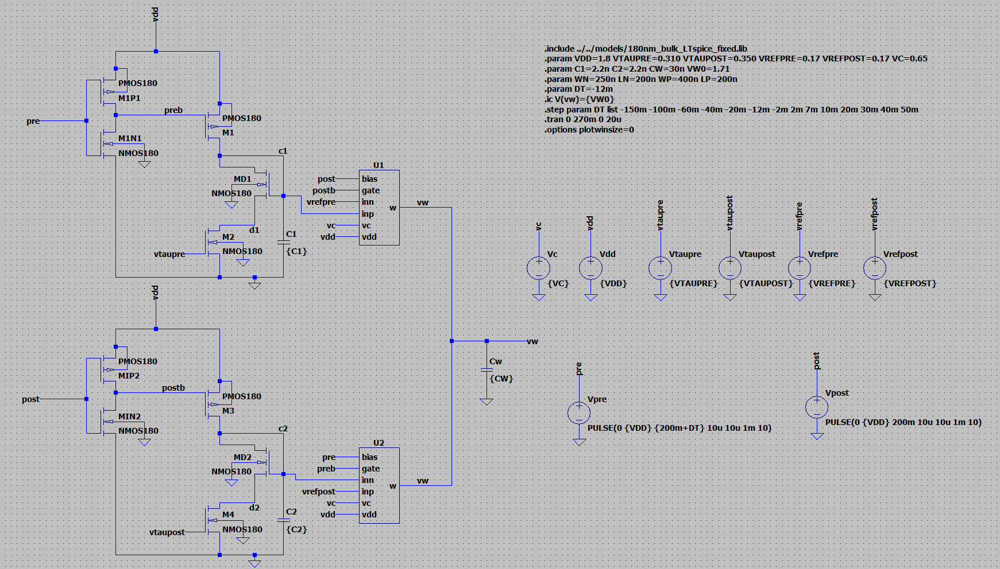</td>
      <td>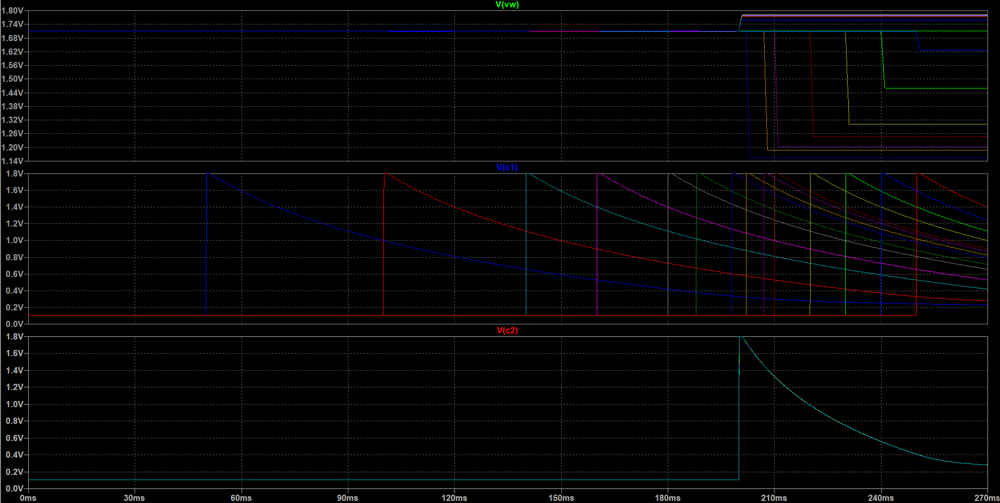</td>
    </tr>
  </table>
  <p><em>Top: Weight potential <code>V(vw)</code> showing bidirectional weight change across 14 timing intervals; Middle: Pre trace <code>V(c1)</code>; Bottom: Post trace <code>V(c2)</code>.</em></p>
</div>

### STDP Parameter Sweeps:
$$\Delta t \in \{-150\text{ms}, -100\text{ms}, -60\text{ms}, -40\text{ms}, -20\text{ms}, -12\text{ms}, -2\text{ms}, +2\text{ms}, +7\text{ms}, +10\text{ms}, +20\text{ms}, +30\text{ms}, +40\text{ms}, +50\text{ms}\}$$

The resulting trajectory reproduces the asymmetric exponential learning window characteristic of biological synapses.

---

## 4. Low-Voltage Optimization (0.6V Ultra-Low Power)

Standard subthreshold circuits suffer severe degradation when supply voltage drops near $V_{th}$. To operate the neuron reliably at **$V_{DD} = 0.6\text{ V}$** (a **67% reduction** in supply voltage and an order-of-magnitude reduction in static power):

1. **Doubled Schmitt Trigger Length ($L_{SN} = L_{SP} = 400\text{ nm}$)**: Mitigates drain-induced barrier lowering (DIBL) and stabilizes subthreshold hysteresis thresholds.
2. **$16\times$ Wided Reset Transistor ($W_{M2} = 4.0\ \mu\text{m}$)**: Compensates for exponentially reduced gate overdrive at $0.6\text{ V}$, ensuring complete membrane discharge within the refractory window.
3. **Scaled Membrane Capacitance ($C_m = 25.3\text{ nF}$)**: Tuned to maintain biological integration time constants.

<div align="center">
  <table>
    <tr>
      <td align="center"><b>Optimized 0.6V Schematic (<code>LIF_R6_S1_toneburst.asc</code>)</b></td>
      <td align="center"><b>0.6V Spiking Waveforms (<code>LIF_R6_S1_toneburst.raw</code>)</b></td>
    </tr>
    <tr>
      <td>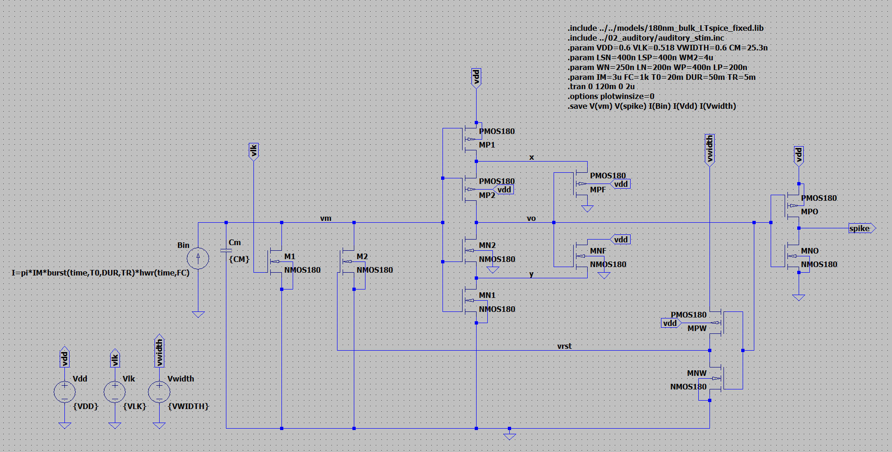</td>
      <td>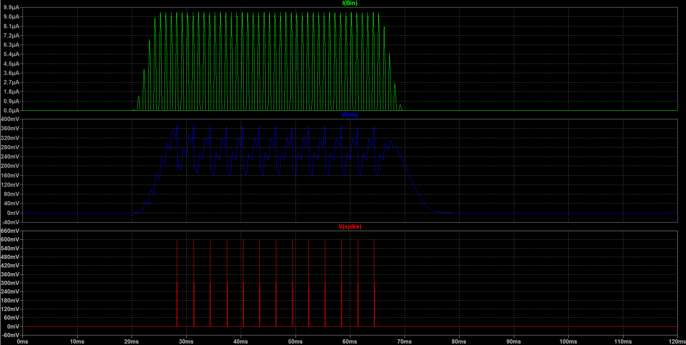</td>
    </tr>
  </table>
  <p><em>Robust rail-to-rail 600mV action potentials under auditory toneburst stimulus with subthreshold membrane oscillation between 160mV and 360mV.</em></p>
</div>

---

## 5. Technology Scaling (180nm → 90nm → 65nm)

The designs were re-targeted and benchmarked across three process generations using BSIM3v3 Predictive Technology Models (PTM):

| Technology Node | Channel Length ($L_{min}$) | Model Library | Supply Range | Status |
|:---:|:---:|:---:|:---:|:---:|
| **180nm Bulk** | $200\text{ nm}$ | `180nm_bulk_LTspice_fixed.lib` | $1.8\text{ V} \to 0.6\text{ V}$ | Baseline & Optimization Verified |
| **90nm Bulk** | $90\text{ nm}$ | `ptm90_LTspice.lib` | $1.2\text{ V} \to 0.9\text{ V}$ | Functional & Benchmarked |
| **65nm Bulk** | $65\text{ nm}$ | `ptm65_LTspice.lib` | $1.0\text{ V} \to 0.7\text{ V}$ | Scaled Core Verified |

---

## 6. Physical Layout Gallery (Electric VLSI)

All physical layouts were implemented in **Electric VLSI 9.08** using MOSIS submicron CMOS design rules (`mocmos`). The design library is stored in [`layout/ISE3_layout.jelib`](layout/ISE3_layout.jelib).

<div align="center">
  <table>
    <tr>
      <td align="center"><b>Full STDP Synapse Layout (Hierarchical)</b></td>
      <td align="center"><b>LIF Spiking Neuron Layout</b></td>
    </tr>
    <tr>
      <td>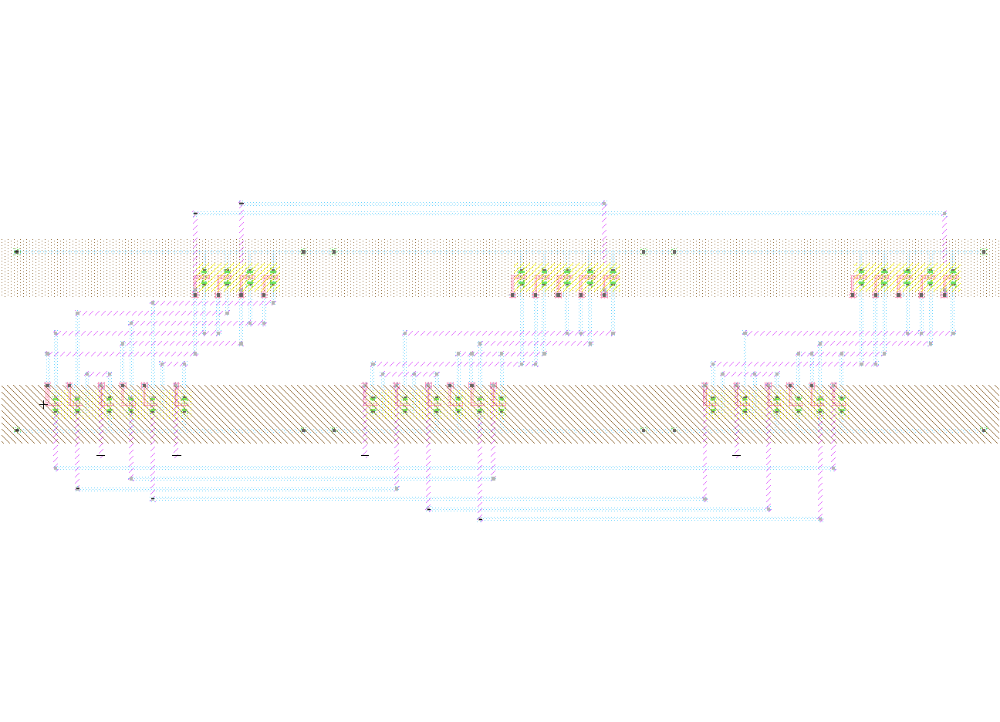</td>
      <td>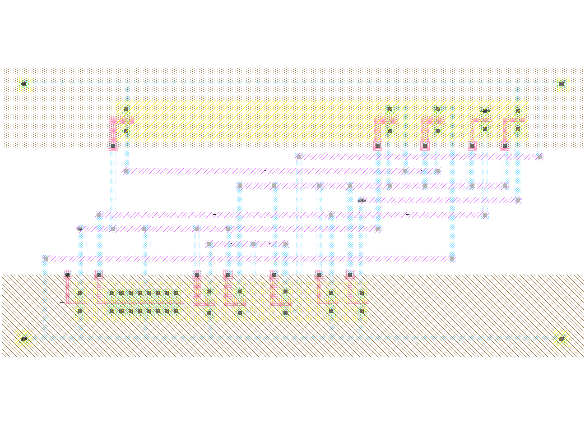</td>
    </tr>
    <tr>
      <td align="center"><b>Operational Transconductance Amplifier (OTA)</b></td>
      <td align="center"><b>Dual Trace Generator (TRACE)</b></td>
    </tr>
    <tr>
      <td>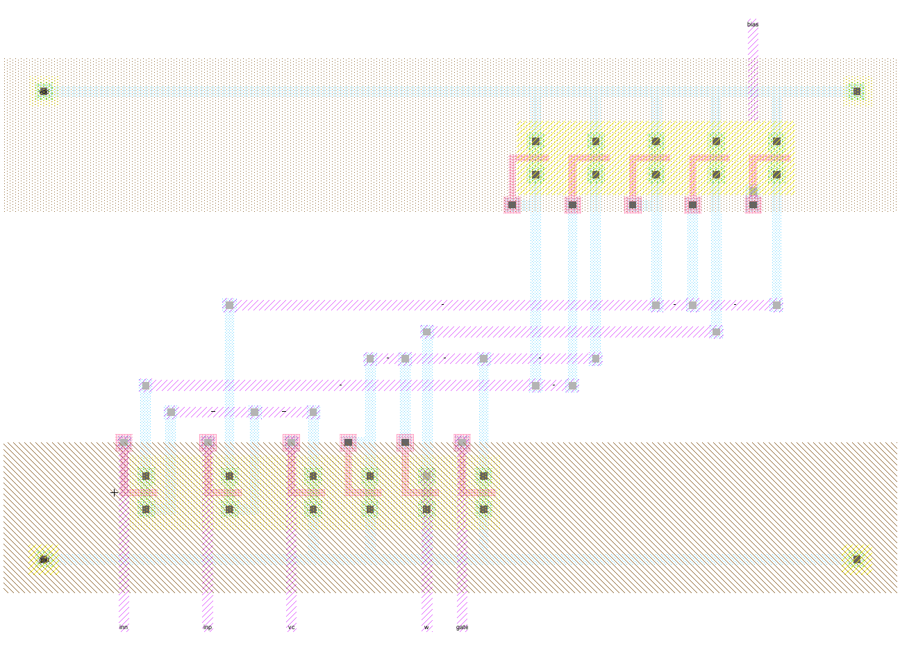</td>
      <td>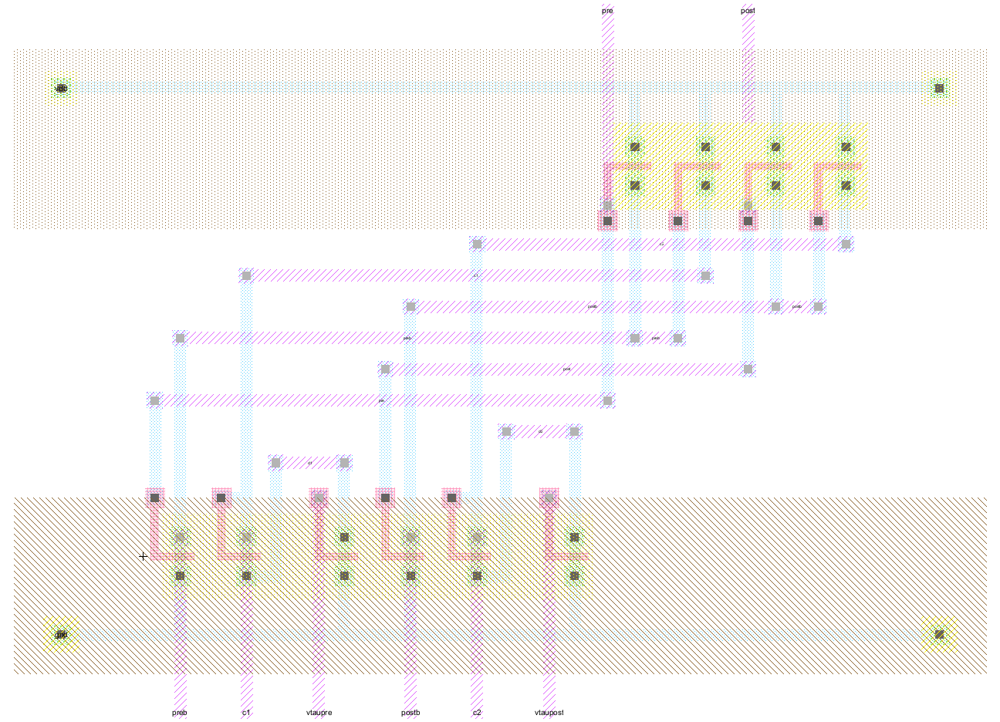</td>
    </tr>
  </table>
</div>

### Layout Highlights:
- **Clean DRC/ERC**: Verified against MOSIS scalable rules with continuous guard rings and substrate taps.
- **Hierarchical Construction**: Basic `inv` cell $\to$ `OTA` & `TRACE` blocks $\to$ Top-level `STDP` synapse.
- **Parasitic Minimization**: Multi-finger diffusions used for wide transistors ($M_2$ reset switch).

---

## 📂 Repository Structure

```
.
├── .gitignore                         # Excludes large (>100MB) transient simulation binaries
├── README.md                          # Comprehensive documentation
├── assets/                            # Schematics, waveform plots, and layout figures
│   ├── circuit_schematics_paper.png
│   ├── 01_lif_baseline_sch.png / 01_lif_baseline_plot.png
│   ├── 02_auditory_toneburst_sch.png / 02_auditory_toneburst_plot.png
│   ├── 03_auditory_rate_level_sch.png / 03_auditory_rate_level_plot.png
│   ├── 04_auditory_am_sch.png / 04_auditory_am_plot.png
│   ├── 05_stdp_sch.png / 05_stdp_plot.png
│   ├── 06_optimized_0v6_sch.png / 06_optimized_0v6_plot.png
│   └── layout_LIF.png / layout_OTA.png / layout_STDP.png / layout_TRACE.png
├── layout/                            # Electric VLSI layout files
│   ├── ISE3_layout.jelib             # Electric VLSI library containing 5 cells
│   └── figures/                       # Vector (SVG) and high-res layout renderings
├── models/                            # Transistor model libraries
│   ├── 180nm_bulk_LTspice_fixed.lib  # 180nm BSIM3v3 PTM model
│   └── ptm/                          # 90nm and 65nm PTM libraries
└── ltspice/                           # LTspice simulation suites
    ├── 01_LIF_baseline/              # Fig 10, 11a, 11b, 15 baseline characterizations
    ├── 02_auditory/                  # S1 (toneburst), S2 (sustained), S3 (gap), S4 (AM), S5 (rate-level)
    ├── 03_PartC_optimization/        # 0.6V ultra-low voltage optimization testbenches
    ├── 04_STDP/                      # OTA characterization & Fig 14 STDP learning sweeps
    └── 06_PartB/                     # Scaled technology runs (65nm and 90nm)
```

---

## 🚀 Quick Start: Simulation & Reproduction

### Prerequisites
- **LTspice**: Download and install from [Analog Devices](https://www.analog.com/en/resources/design-tools-and-calculators/ltspice-simulator.html).
- **Electric VLSI**: Download version 9.08 from [GNU Electric](https://www.gnu.org/software/electric/).

### Running Simulations
1. Clone this repository:
   ```bash
   git clone https://github.com/anujgite10-10/subthreshold-neuromorphic-lif-stdp.git
   cd subthreshold-neuromorphic-lif-stdp
   ```
2. Open any `.asc` file directly in LTspice (e.g. `ltspice/02_auditory/LIF_R3_S1_toneburst.asc`).
3. Click the **Running Man (Simulate)** icon.
4. LTspice will automatically load the matching `.plt` configuration to restore all signal traces.

---

## 📚 References

1. **M. Yang, et al.**, *"Design and Analysis of an Ultra-Low-Power CMOS Spiking Neuron and STDP Synapse for Neuromorphic Applications,"* **IEEE/ACM International Symposium on Low Power Electronics and Design (ISLPED)**, 2021.
2. **Predictive Technology Model (PTM)**, Nanoscale Integration and Modeling (NIMO) Group, Arizona State University ([ptm.asu.edu](https://ptm.asu.edu)).
3. **Electric VLSI Design System**, Version 9.08, GNU Software Foundation.

---

<div align="center">
  <b>Developed for Advanced Neuromorphic VLSI Research</b>
</div>

